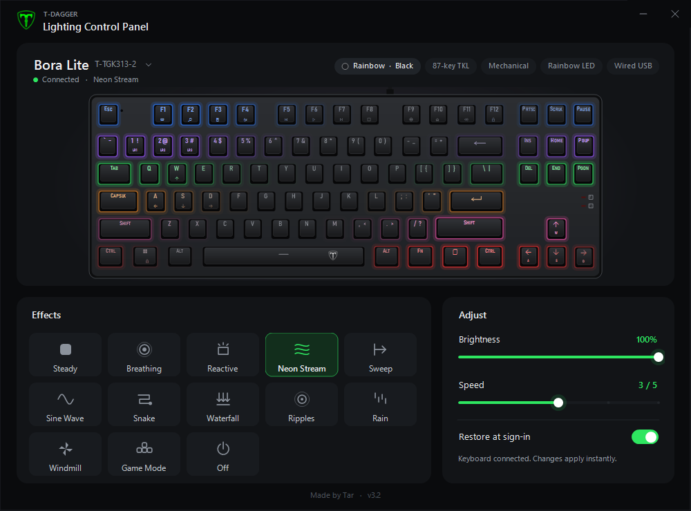

# T-Dagger Lighting Control Panel for the Bora Lite keyboard

**Free Windows app to change the lighting on the T-Dagger Bora Lite rainbow keyboard (T-TGK313) with one click: effects, speed and brightness, a live preview, and your setting restored at every sign-in.**

Works with: **T-TGK313-2** · **T-TGK313GB-LIT** · **T-TGK313W-LIT** (Bora Lite Rainbow, USB ID `258A:013B`)



## Why I made this

Changing the lighting on the Bora Lite means remembering Fn key combinations and cycling through modes, speeds and brightness levels one press at a time, with no way to see what comes next. It's tedious.

So I built this app to make life easier for everyone who owns this keyboard: click an effect, drag a slider, done. You see every effect before you pick it, and the app remembers your choice.

It's free, open source, and made entirely by me. I'd love your feedback. If you find a bug, something doesn't work on your keyboard, or you want a feature, please [open an issue](../../issues/new). Every report helps.

## Download

1. Go to [**Releases**](../../releases/latest) and download the zip.
2. Extract it and double-click **Install.cmd**.

That's it. It installs for your Windows user only (no admin rights), adds Desktop and Start menu shortcuts, and opens the app.

Windows may show a blue SmartScreen box the first time, because the app isn't code-signed (signing costs money every year). Click **More info**, then **Run anyway**. The full source code is here if you want to check it or build it yourself.

To remove it, run **Uninstall.cmd** from the same zip.

## What it does

- **All 12 built-in effects plus Off:** Steady, Breathing, Reactive, Neon Stream, Sweep, Sine Wave, Snake, Waterfall, Ripples, Rain, Windmill and Game Mode (lights W A S D and the arrow keys).
- **Speed and brightness** sliders, 5 speeds and 6 brightness levels.
- **Live preview that matches your keyboard.** It's drawn from the real keyboard, with effect timings measured on video from a real one. Every change restarts the effect on the keyboard and the preview together, so they stay in sync.
- **Pick your model** (black, gray/black or white) and the preview matches how your keyboard looks.
- **Restores your setting at sign-in**, then closes. Nothing keeps running in the background.
- **Game friendly.** The preview stops drawing when the window is minimized or a fullscreen game is in front: 0% CPU, about 20 MB of memory.
- **Private.** No internet access, no update checks, no account, no telemetry.

## Supported keyboards

| Model | Edition | Status |
|---|---|---|
| T-TGK313-2 | Bora Lite Rainbow, black | Tested on a real keyboard |
| T-TGK313GB-LIT | Bora Lite Rainbow Lite, gray / black | Should work, not yet confirmed |
| T-TGK313W-LIT | Bora Lite Rainbow Lite, white | Should work, not yet confirmed |

All three use USB ID `258A:013B`, the same ID T-Dagger's own Bora Lite software is built for. The keyboard doesn't tell Windows which version it is, so you pick yours from the menu next to the name. That only changes how the preview looks.

**Own the gray or white version?** Please [open an issue](../../issues/new) and say whether it worked. That's how they move to "confirmed".

These keyboards have fixed rainbow LEDs, one color per row (blue, purple, green, orange, pink, red from the top). That's the hardware, so no software can set a single solid color on them.

Other T-Dagger keyboards (Arena and others) use different hardware. The app doesn't detect them and never sends them anything.

## Is it safe for my keyboard?

Yes. The app only changes lighting, and every command is checked before it's sent:

- It talks only to USB ID `258A:013B`, on the keyboard's lighting interface.
- It sends lighting report `0x0A` (mode, speed, brightness). It always reads the keyboard's current report first, checks it, and changes only those three values. If anything looks unexpected, it sends nothing.
- For Game Mode only, it first sends the list of lit keys (report `0x0B` page 1), copied byte for byte from the official app.
- It never sends key mapping, firmware or bootloader commands.

Everything is in one readable file: [`src/ControlPanel.cs`](src/ControlPanel.cs).

## Feedback, bugs and feature requests

This is a one-person project, and feedback is what makes it better.

- **Bug or problem:** [open an issue](../../issues/new). Say which model you have, what you did and what happened. If the app logged an error, attach `log.txt` from `%APPDATA%\T-Dagger Lighting Control Panel`.
- **Feature idea:** open an issue and describe it.
- **Works on your keyboard?** That's useful too, especially for the gray and white versions.

## Build it yourself

Windows 10 and 11 already include the C# compiler this uses, so there's nothing to install. Download or clone this repository and run:

```
build.cmd
```

It creates `T-Dagger Lighting Control Panel.exe`. Run `Install.cmd` to install that build.

## Where things are stored

- App: `%LOCALAPPDATA%\Programs\T-Dagger Lighting Control Panel`
- Settings and log: `%APPDATA%\T-Dagger Lighting Control Panel`
- Sign-in restore: registry `HKCU\Software\Microsoft\Windows\CurrentVersion\Run`, value `TDaggerLightingControlPanel` (switch it off in the app with *Restore at sign-in*)

## Disclaimer

This is an unofficial, fan-made app. It isn't made, endorsed or supported by T-Dagger. "T-Dagger", "Bora" and the T-Dagger logo belong to their owner and are used here only to identify the keyboard the app works with.

## Credits and license

Made by **Tar**. Released under the [MIT License](LICENSE): free to use, share and modify.
